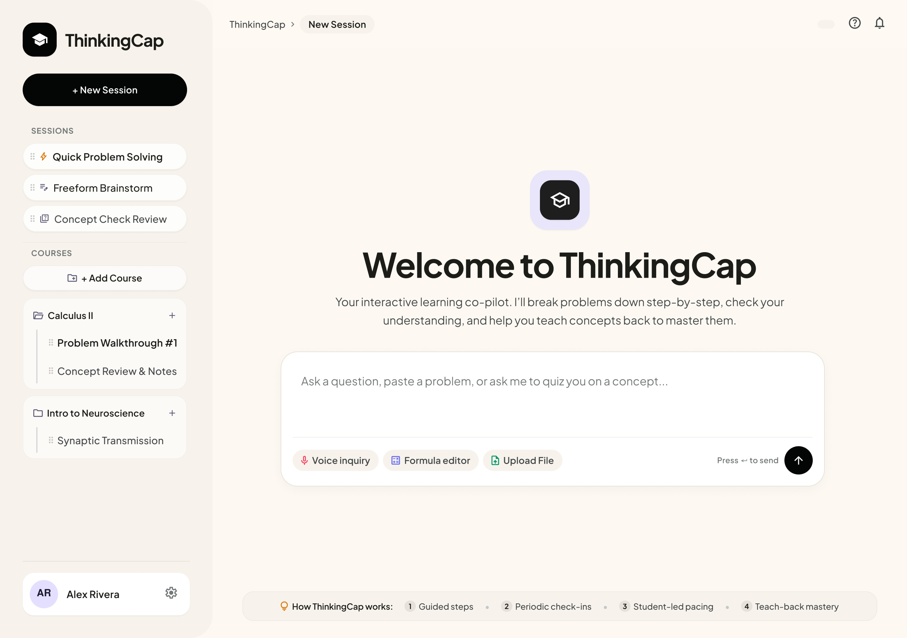
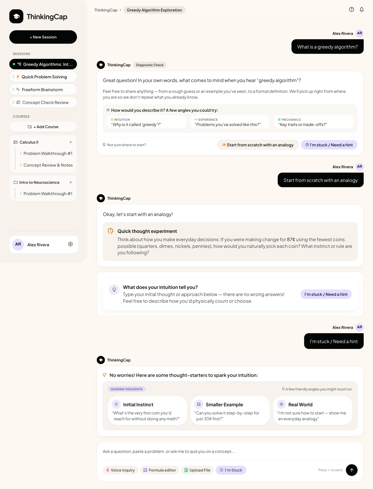
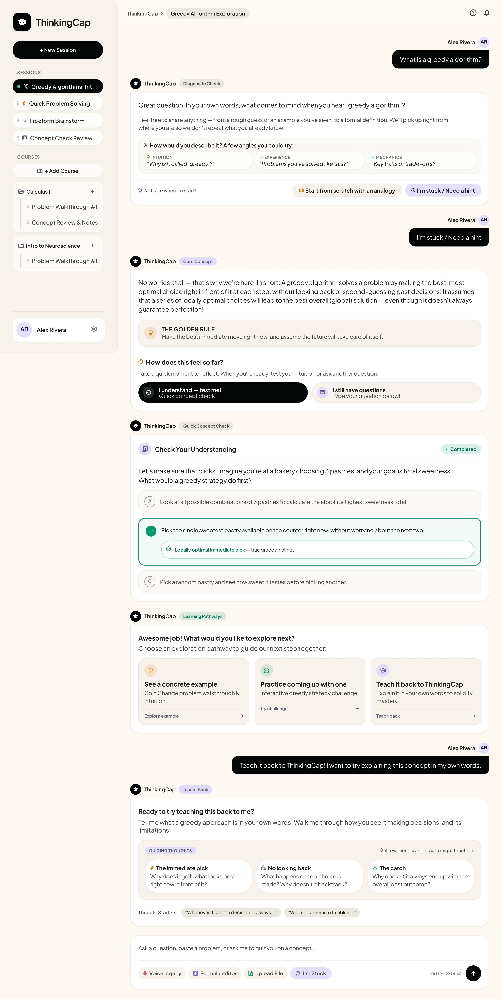

# Design for ThinkingCap
Here is the proposed design for ThinkingCap, walking through some example workflows. All these prototypes can be viewed in the links below:
 
[Figma](https://www.figma.com/design/OZjiIN9DdaXCJ3SQyxketd/ThinkingCap?node-id=0-1&t=LZI9EoXBGWeBxNSD-1)
 
[Interactive Prototype](https://www.figma.com/proto/OZjiIN9DdaXCJ3SQyxketd/ThinkingCap?node-id=87-5020&p=f&viewport=-17%2C63%2C0.39&t=TV6FZISjfvXft92T-1&scaling=min-zoom&content-scaling=fixed&page-id=87%3A4197)

## Hero Page

## Example Workflow 1

## Example Workflow 2

