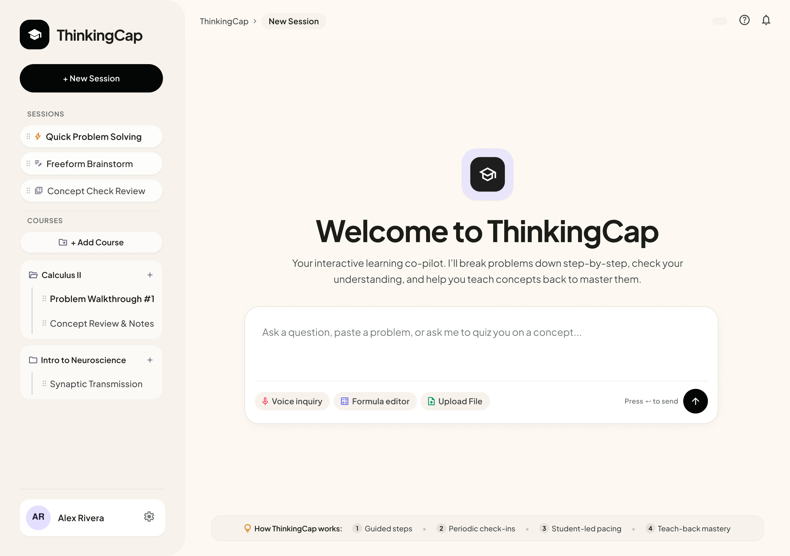
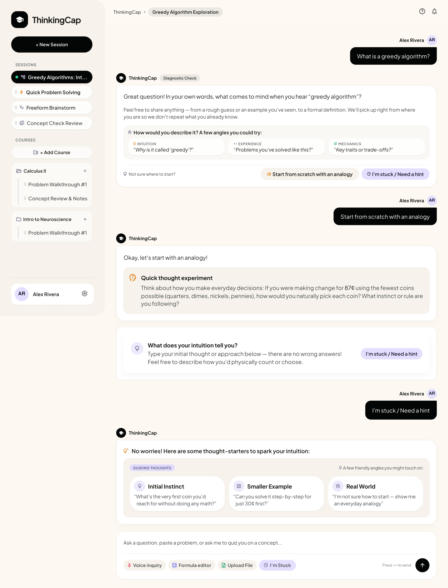
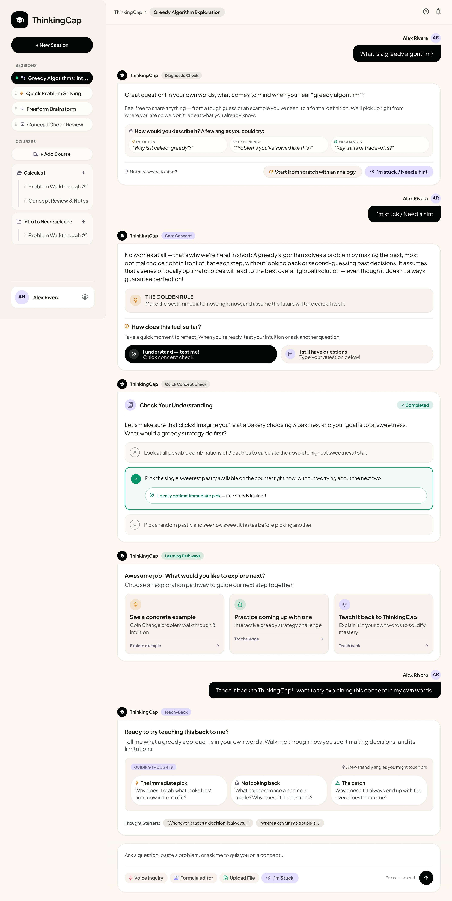
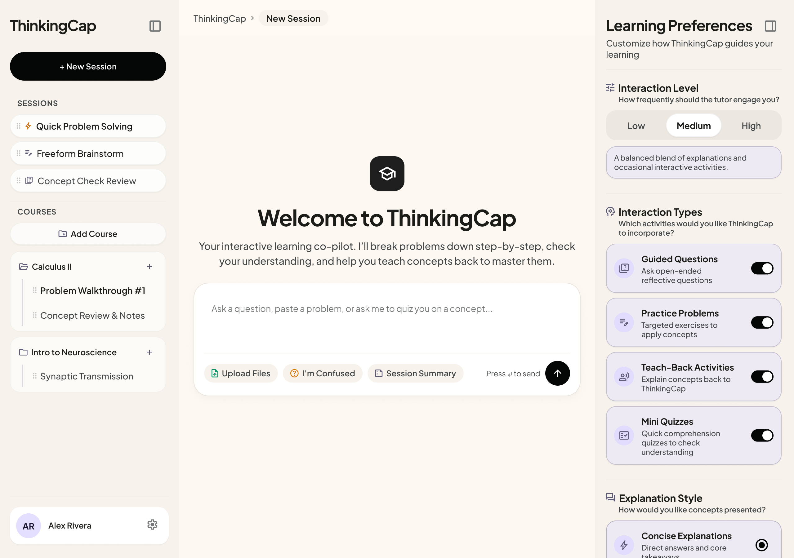
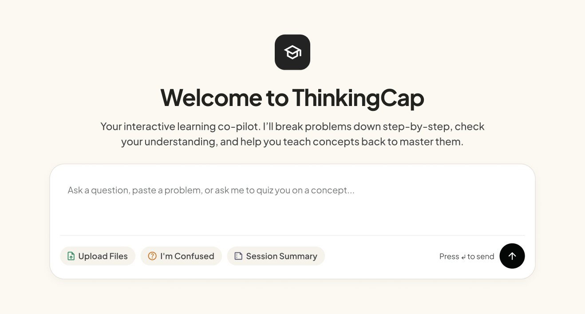

# ThinkingCap: Design Process

## 1. The Challenge
AI tools have the potential to support students' learning, but their use also raises concerns about over-reliance and the development of independent problem-solving skills.

In *Role of Interactive AI Tools in the Future of Education*, Singh (2025) discusses both the benefits and challenges of interactive AI in educational settings. The study reports that 75% of respondents felt AI improved their grades and 68% felt it helped them better understand course material, while also identifying concerns about over-reliance on AI and its potential effects on critical thinking.

These findings highlight a design challenge:
**How might we design an AI tutoring experience that supports students' understanding without encouraging them to passively accept generated answers?**

## 2. Research-Informed Design Direction
Recent research suggests that AI-powered learning platforms may support learning by combining flexible content presentation with opportunities for interaction and assessment.

Heldreth et al. (2026) evaluated Learn Your Way, an AI-powered platform that transforms textbook chapters into different representations and incorporates assessment features. In an experiment involving 60 students aged 15–18, students using the platform reported a more positive learning experience and demonstrated better overall learning outcomes than students using a digital textbook. However, the study did not find a statistically significant difference on its reading-comprehension task, highlighting the importance of evaluating specific learning outcomes rather than assuming that a more interactive experience always produces better results.

Research on individual interface features provides additional direction for interaction design. Chen and Zhang (2026) investigated five features in AI-driven digital learning systems: adaptive feedback, conversational agents, gamification, progress visualization, and micro-assessments. Their controlled experiment with 240 participants found that conversational agents and adaptive feedback positively influenced usability, while gamification had a particularly strong relationship with engagement. Their findings suggest that how learners interact with a system—not just the information it provides—can be an important consideration in educational interface design.

### Initial design principles
These findings informed our initial focus on:
- Breaking explanations into manageable steps.
- Incorporating comprehension checks throughout the learning experience.
- Providing feedback that helps students understand their mistakes.
- Encouraging students to explain concepts in their own words.
- Giving students opportunities to reflect on what they have learned.

These principles guided our exploration of interaction patterns for ThinkingCap. Since our prototype was not evaluated through a formal user study, they represent research-informed design decisions rather than validated evidence that ThinkingCap improves learning outcomes.

## 3. Iteration 1: Exploring Interactive Learning Patterns
### Initial interaction patterns
Drawing from the research, we brainstormed several interaction patterns that could encourage active learning and critical thinking.

| Interaction pattern | Intended purpose |
|---|---|
| Reflection prompts | Encourage students to think about and reflect on the topics they are learning. |
| Scaffolded explanations | Break complex ideas into smaller concepts and manageable steps. |
| Guided questions | Ask students questions that encourage them to think through a concept instead of immediately receiving an answer. |
| Practice problems | Give students opportunities to independently apply what they have learned. |
| Teach-back activities | Ask students to explain a concept in their own words and provide feedback on missing or misunderstood ideas. |
| Comprehension checks | Incorporate short questions or quizzes to help students assess their understanding. |
| Visual explanations | Use AI-generated images or other visuals to supplement explanations when appropriate. |

### Initial design exploration
#### Hero Page

#### Example Workflow 1

#### Example Workflow 2

Our first iteration explored how these interaction patterns could be incorporated into an AI tutoring conversation. The goal was to move beyond a traditional question-and-answer experience by encouraging students to participate in their learning through questions, practice, and reflection.

### Identifying an opportunity for greater learner control
As we reviewed existing AI tutoring tools, including Macmillan Learning Achieve AI Tutor, Khanmigo, ChatGPT Study Mode, AutoTutor, GPTutor, and Kindos Tutor, we noticed that many already incorporated interactive learning techniques such as guided questions, practice problems, and comprehension checks.

This led us to consider a different design opportunity: **How might we give students greater control over how they interact with an AI tutor?**

Rather than treating interactive learning as a fixed experience, we wanted students to be able to choose which activities they found useful and how frequently they wanted to participate in them.

## 4. Iteration 2: Introducing Customizable Learning Preferences
Based on our initial exploration, we refined the design to give students more control over their tutoring experience.

We initially considered asking students to establish their learning preferences during account creation. However, learning needs may vary depending on the subject, task, or individual student. Preferences established during onboarding may not remain appropriate throughout a student's learning experience.

To address this, we moved these preferences into an accessible sidebar that students can open and modify at any point during a tutoring session. This allows students to adjust their experience without having to restart a conversation or lose their progress.

### 4.1 Adjustable Interaction Level
**Question: How frequently should the tutor engage you in interactive activities?**

Students can choose from three levels of interaction:
- **Low:** Primarily explanation-based learning, with interactive activities introduced occasionally or when requested.
- **Medium (Default):** A balance between explanations and interactive activities, with periodic questions and opportunities to practice.
- **High:** Frequent engagement through guided questions, practice problems, comprehension checks, and opportunities to explain concepts.

This setting controls the frequency of interactions rather than the specific activities presented.

### 4.2 Preferred Interaction Types
**Question: Which learning activities would you like the tutor to incorporate?**

Students can independently enable or disable the following activities:
- **Guided Questions:** The AI asks reflective questions to encourage critical thinking and guide students toward understanding.
- **Practice Problems:** Students apply concepts through exercises and receive feedback on their attempts.
- **Teach-back Activities:** Students explain concepts in their own words and receive feedback on their understanding.
- **Comprehension Checkpoints:** Short questions or quizzes help students assess their understanding throughout the session.

By separating interaction frequency from interaction type, students can customize both how often the tutor engages them and which activities they prefer.

### 4.3 Explanation Style
**Question: How would you prefer the tutor to explain concepts?**
We also separated explanation style from interactive activities because the way information is presented is different from how students participate in learning.

Students can choose between:
- **Concise Explanations:** Shorter, more direct explanations that focus on the key information.
- **Step-by-Step Explanations:** More detailed, scaffolded explanations that break concepts or problem-solving processes into smaller steps.

### 4.4 In-Session Customization

The updated side panel brings these three settings together in one accessible location. Students can modify their preferences throughout a tutoring session as their needs change.

We also considered how different combinations of settings should behave:
- **Low interaction + all activities enabled:** The tutor primarily provides explanations but occasionally incorporates one of the selected activities.
- **Medium or High interaction + no activities selected:** The tutor continues providing explanations and can invite the student to select an activity rather than assuming which interactions they prefer.

The intention is to keep the tutoring experience flexible without making the settings restrictive. Students can still request a particular activity or type of explanation directly through the conversation, regardless of their saved preferences.

## 5. Session Summary Feature
We also wanted to provide students with a way to review the topics covered during a tutoring session and reinforce important takeaways.

Initially, we considered generating a summary automatically at the end of each session. However, we recognized that defining the end of a learning session could be difficult. Students may leave a conversation and return to it hours or even days later, making it unclear when a session should be considered complete.

To address this, we introduced an on-demand **Session Summary** feature.

Rather than relying on an automatic end-of-session trigger, students can select the Session Summary button whenever they want a recap of the conversation so far.

The summary is intended to:
- Recap the main topics and concepts discussed.
- Highlight important explanations and key takeaways.
- Summarize learning activities and questions explored.
- Identify concepts or areas that may benefit from further review.

We placed the button beneath the text input, alongside other available tools such as Upload Files and "I'm Confused." This keeps the feature easily accessible without interrupting the tutoring conversation.

By making summaries available on demand, students can review their learning progress whenever they need to, rather than relying on an arbitrary session endpoint.

## 6. Further Design Considerations
### Adaptive learning preferences
We also considered whether ThinkingCap could recognize patterns in a student's feedback and suggest adjustments to their preferences.

For example, if a student has selected concise explanations but repeatedly asks the tutor to explain concepts step by step, ThinkingCap could ask whether they would like to change their default explanation style.

Rather than automatically modifying preferences, the tutor would suggest the adjustment and allow the student to decide whether to apply it.

This would provide another way for students to personalize their experience while keeping control of their learning preferences.

## 7. Overall Design Goals
Through these iterations, ThinkingCap evolved from an exploration of interactive tutoring techniques into a more customizable tutoring experience.

Our final design direction focuses on:
1. **Active Learning:** Encourage students to participate through questions, practice, reflection, and teach-back activities.
2. **Learner Autonomy:** Allow students to choose how frequently they interact with the tutor and which activities they prefer.
3. **Flexible Personalization:** Make learning preferences accessible and adjustable throughout a tutoring session.
4. **Learning Reflection:** Provide on-demand summaries that help students review previously discussed material and identify areas for further learning.

Our goal is to explore how an AI tutor can move beyond simply providing answers and instead support a more engaging, flexible, and learner-directed experience.